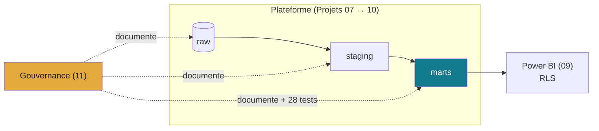

# Projet 11 — Cadre de gouvernance & qualité des données

> Quand la donnée grandit, personne ne sait plus **ce qu'elle signifie, d'où elle
> vient, ni si elle est fiable**. Ce projet met en place un cadre de gouvernance
> léger mais complet sur la plateforme des [Projets 07 → 10](https://github.com/valentinratigniet-byte)
> (base PostgreSQL + pipeline ELT + dashboard) : documentation, qualité automatisée,
> lignage, conventions, propriété et SLA.

🗺️ **[Schéma du dépôt (GitDiagram)](https://gitdiagram.com/valentinratigniet-byte/projet-11-gouvernance)** : vue d'ensemble générée automatiquement à partir du code.

## 🏛️ Les 6 piliers



| Pilier | Ce que ça garantit | Document |
|---|---|---|
| **Dictionnaire de données** | chaque table/champ a un sens, un owner, une règle | [docs/dictionnaire-donnees.md](docs/dictionnaire-donnees.md) |
| **Conventions de nommage** | un nom se lit sans doc | [docs/conventions-nommage.md](docs/conventions-nommage.md) |
| **Qualité automatisée** | 28 tests dbt bloquent les données incohérentes | [docs/qualite.md](docs/qualite.md) |
| **Lignage** | l'impact d'un changement est traçable | [docs/lignage.md](docs/lignage.md) |
| **Propriété & accès** | qui répond de quoi, qui accède à quoi | [docs/ownership-sla.md](docs/ownership-sla.md) |
| **SLA de fraîcheur** | la donnée est promise à une fraîcheur, l'écart alerte | [docs/ownership-sla.md](docs/ownership-sla.md) |

## ✅ Ce qui est réellement enforced (pas que du document)

- **28 tests de qualité dbt** exécutés sur le périmètre 07/10 → `PASS=28, ERROR=0`
  (unicité, complétude, intégrité référentielle, validité de domaine). Ce repo ne
  contient pas de code exécutable — les 28 tests tournent réellement dans le
  pipeline du [Projet 10](https://github.com/valentinratigniet-byte/projet-10-pipeline-elt),
  vérifiable en direct :
  [](https://github.com/valentinratigniet-byte/projet-10-pipeline-elt/actions/workflows/ci.yml)
- **Lignage généré par dbt** (à partir du code `ref()`/`source()`, donc exact par
  construction) — instantané navigable dans [`dbt-docs/`](dbt-docs/) (`index.html`).
- **RLS** en place sur le dashboard (projet 09) : accès restreint par pays.

## 🗂️ Contenu

```
projet-11-gouvernance/
├── README.md
├── docs/
│   ├── dictionnaire-donnees.md   ← catalogue raw/staging/marts (sens + owner + règle)
│   ├── conventions-nommage.md    ← charte de nommage
│   ├── qualite.md                ← règles + suivi (scorecard 28/28)
│   ├── lignage.md                ← DAG source → marts → BI + dbt docs
│   └── ownership-sla.md          ← propriété, accès, SLA de fraîcheur
└── dbt-docs/                     ← catalogue + lignage générés par dbt (navigables)
```

## 👀 Consulter le lignage interactif

Ouvre `dbt-docs/index.html` dans un navigateur (catalogue + graphe de dépendances),
ou régénère-le à la source :

```bash
cd ../projet-10-pipeline-elt/dbt_ecommerce
export DBT_PROFILES_DIR=$PWD
python -m dbt.cli.main docs generate && python -m dbt.cli.main docs serve
```

---

*Projet 11 du [Portfolio Data](https://github.com/valentinratigniet-byte). Gouverne la plateforme construite aux projets
07 (base), 08 (SQL), 09 (dashboard) et 10 (pipeline).*
