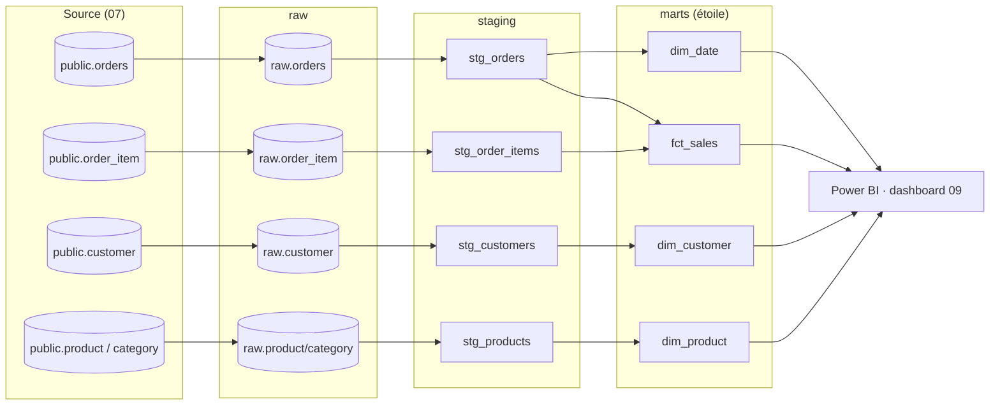

# Lignage des données (data lineage)

D'où vient chaque donnée, par quelles transformations elle passe, et qui la
consomme. Le lignage rend l'impact d'un changement **traçable** (si je modifie
`raw.orders`, quoi casse en aval ?).

## Vue d'ensemble



## Lignage interactif (dbt docs)

Le graphe navigable (chaque nœud cliquable, dépendances amont/aval) est **généré
automatiquement** par dbt à partir des `ref()` et `source()` du code — il ne peut
pas mentir sur les dépendances réelles.

```bash
cd projet-10-pipeline-elt/dbt_ecommerce
export DBT_PROFILES_DIR=$PWD        # Windows : set DBT_PROFILES_DIR=%CD%
python -m dbt.cli.main docs generate
python -m dbt.cli.main docs serve   # ouvre le catalogue + le DAG dans le navigateur
```

Un instantané est versionné dans [`dbt-docs/`](../dbt-docs/) (`index.html` +
`manifest.json` + `catalog.json`) pour consultation sans relancer dbt.

## Règle de gouvernance

- Toute transformation passe par dbt (`ref`/`source`) → **le lignage reste exact**
  par construction. Pas de SQL « hors pipeline » qui contournerait la traçabilité.
- Un changement de schéma source se répercute visiblement : les tests dbt en aval
  échouent, signalant l'impact avant la mise en production.
